# Visual fidelity report

Closing visual comparison of the Unity build ("Paint Squad Wars", an unofficial fan study) against the 2015 mobile game "Tactile Wars" by Ankama. Date: 2026-11-17.

## Read this first

- The original is **2D sprite art**. In the main reference shots it is drawn on a **grey lava biome** (ps_12, f_0056, f_0086: grey-brown hex stone with orange cracks) or, in ps_06, an olive biome with rain. This build is **3D models under an orthographic camera on a sand biome**, which is an owner requirement. Pixel identity was never the goal; the goal was the same visual read (silhouette, scale, palette hierarchy, effect vocabulary).
- A lava biome, a rain effect and a green biome were never built. Any "Differs" line that mentions ground colour is therefore a known, accepted difference.
- No similarity percentages are given anywhere. Everything below is an eyeball judgement made by looking at the images listed. The earlier eyeball notes are in `Comparisons/NOTES.md`; this report re-checked the seven comparison images and the screenshots first-hand and agrees with those notes, with the corrections stated explicitly where they apply.
- The side-by-side images in `Comparisons/` were produced in an earlier pass. The final PlayMode run (see `TESTING.md`) regenerates the screenshots in `Screenshots/` but does **not** regenerate the `Comparisons/` images, so the right-hand halves of the comparisons are from that earlier capture. The matching current screenshots are linked next to each comparison.
- Reference images are third-party copyrighted material kept for private study only.

Verification status values used: `compared and close`, `compared with visible differences`, `no reference available`.

## 1. Gameplay overview

| | |
|---|---|
| Reference |  (`References/playstore/ps_12.png`) |
| Unity screenshot | 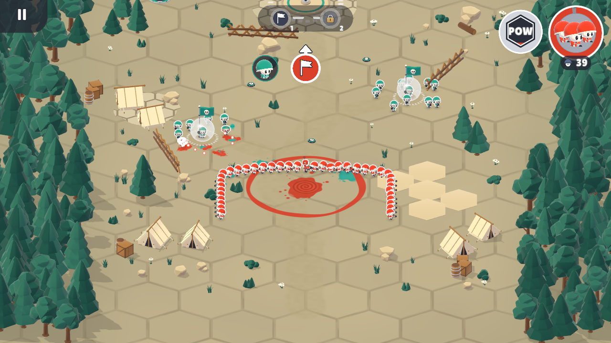 (`Screenshots/battle_u_formation.png`) |
| Side by side |  (`Comparisons/01_gameplay_overview.png`) |

What the images show: reference has a U shaped single-file red squad open toward the camera with a thin red ring and spiral blot inside, enemy flag bearers in white bubbles with thick red C arcs and skull pennants, small enemy clusters spread in loose arcs, mine discs, tents and barricades, pause tab top left, a round squad badge top right. Ours has the same U shaped single-file squad with ring and blot, two enemy clusters around skull-flag bearers in pale bubbles, dotted paint streams, mines, tents and crates, pause tab top left, POW hex and squad badge top right.

Differences:
- Biome: grey lava hex stone with glowing cracks versus our sand hex ground. Ground contrast and hue differ strongly; team colours still read as the most saturated elements in both.
- Our framing is dominated by dense low-poly pine borders on both sides; ps_12 shows open ground.
- The reference spreads many more enemy soldiers in loose rings around the squad; ours keeps small tight clusters around each bearer, so the field looks emptier.
- Bubble arcs: reference has a thick red C shaped arc under each bubble; ours has a thin dashed track that fills only as the bearer takes damage.
- Our HUD has extra elements the reference does not show: capture-progress pill, objective flag marker, edge helmet marker, always-visible POW badge, soldier count pill.
- Our ground is lighter and flatter; the reference has dark soft ground shadows and darker outlines.

Required fixes (not done, listed for a future pass): lava biome with crack glow; wider, looser enemy spacing and higher enemy count; thick bubble arc; trim the HUD extras or make them optional.

Verification status: **compared with visible differences**. Size of soldiers, squad shape, ring plus blot, effect vocabulary and HUD layout are close; biome, enemy distribution and bubble arc are visibly different.

## 2. Gameplay with ring

| | |
|---|---|
| Reference |  (`References/playstore/ps_06.png`) |
| Unity screenshot | 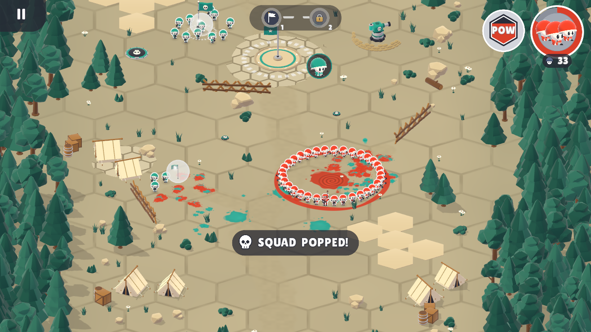 (`Screenshots/battle_formation_circle.png`) |
| Side by side |  (`Comparisons/02_gameplay_ring.png`) |

What the images show: ps_06 has a very large thick red ring with a soft spiral blot, about a dozen red soldiers standing loosely inside the ring, green enemy soldiers around pennant flags, dark skull mine discs ringing the area, light rain streaks, a mercenary icon, and a hex POW badge. Ours has a smaller ring with the whole squad packed on the ring line itself, a large spiral blot, many paint splats in red and teal, a "SQUAD POPPED!" toast, teal enemies, a capture HUD pill and a defender prop at the top.

Differences:
- Ring scale: in ps_06 the ring is much larger relative to the squad and the soldiers stand loosely inside it. Ours is a tight circle on the line (the formation solver spaces circle strokes along the loop).
- Biome and weather: green or olive ground with rain versus sand, no rain.
- Our capture shows extra clutter (toast, many splats, capture pill).
- Soldiers in ps_06 are darker and read as small figures with visible guns; ours read as red domes with white outline.

Required fixes (not done): enlarge the ring relative to a circle formation or add a "stand inside" cluster mode; rain VFX; olive biome.

Verification status: **compared with visible differences**.

## 3. Soldier close-up

| | |
|---|---|
| Reference | crop of  (`References/playstore/ps_12.png`) |
| Unity screenshot | 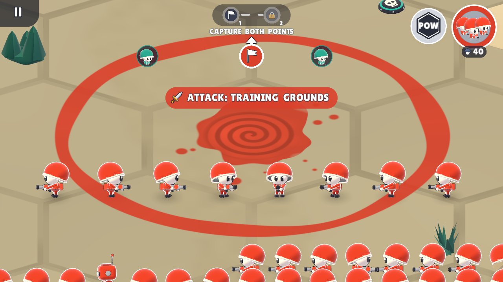 (`Screenshots/soldier_lineup_zoom.png`) and 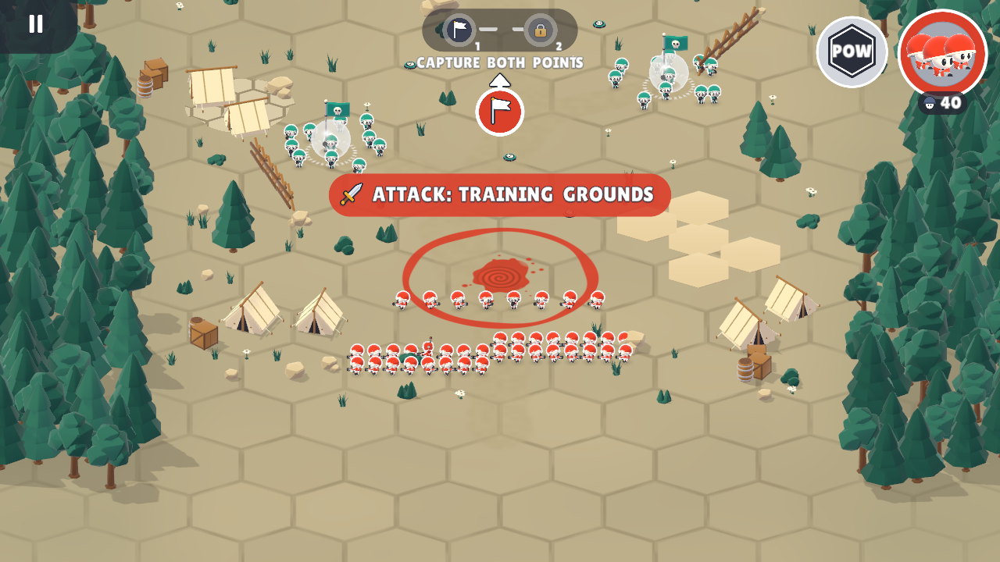; model previews in `Previews/Soldier_gamecam.png` |
| Side by side |  (`Comparisons/03_soldier_closeup.png`) |

What the images show: reference soldiers (4x nearest neighbour crop) are a dark compact body under a red dome with a thin white rim, a grey gun stub pointing sideways, and a soft ground shadow; the top row shows backs. Ours shows a red helmet dome, a white face patch, small body, a heavy white sticker outline around the whole figure and a visible gun.

Differences:
- Our white outline is heavier and brighter than the reference rim; the reference reads darker and more compact.
- Eyes rarely resolve at this size in ours (the model was not re-exported with a bigger face plate).
- Ours leans back and clamps yaw so faces stay visible; the reference shows backs. This is intended by the brief but is a visible difference.
- Reference has a dark outline on body and legs; ours only darkens skin, gun and boots.

Required fixes (not done): thinner white edge on team slots; larger face plate and eyes (needs a Blender re-export); darker body or leg slots.

Verification status: **compared with visible differences**.

## 4. Formation drawing

| | |
|---|---|
| Reference |  (`References/video_frames/f_0056.jpg`) |
| Unity screenshot | 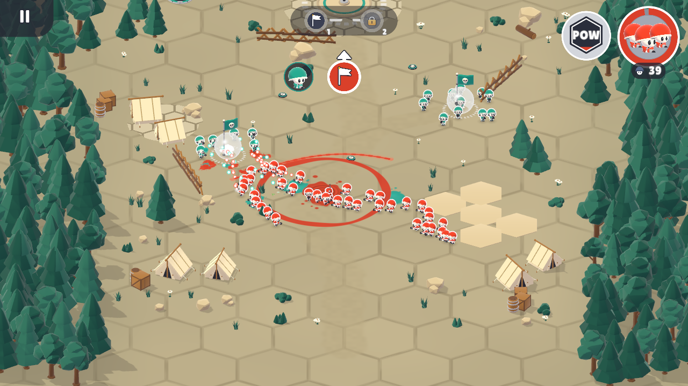 (`Screenshots/battle_stroke_drawing.png`) |
| Side by side |  (`Comparisons/04_formation_drawing.png`) |

What the images show: f_0056 has a thin dashed red line from the ring to the left, a single-file column of about twenty soldiers curling down toward the line, ring plus spiral blot, on an empty lava field. Ours shows a squad streaming along a curved path next to the ring, with enemy squads and splats nearby because the capture happens mid fight.

Differences:
- Reference stroke is a clean thin dashed line on empty ground; ours is partly hidden by soldiers and splats and has a soft glow ribbon the reference does not have.
- The reference chain is a clean single-file column; ours is a single file chain plus a clump near the ring.
- Biome and HUD as in section 1.

Required fixes (not done): remove or narrow the glow ribbon; a clean standalone stroke capture on empty ground for a fair comparison.

Verification status: **compared with visible differences**.

## 5. HUD pause tab

| | |
|---|---|
| Reference |  top-left corner (`References/playstore/ps_12.png`) |
| Unity screenshot |  top-left corner; pause menu in 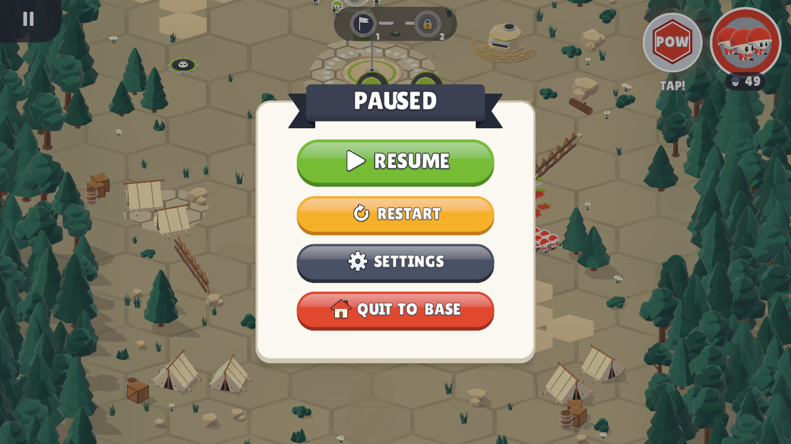 |
| Side by side |  (`Comparisons/05a_hud_pause_tab.png`) |

What the images show: both are a dark slate rounded tab with a grey or white "II" in the top-left corner.

Differences:
- Ours is semi transparent and the trees show through it; the reference tab is opaque dark slate with a softer outline and grey bars.
- The post-processing stack (vignette, grading, bloom) touches our HUD because the canvases render with the main camera. An overlay UI camera was tried and reverted because it vanished from render-texture captures. This is a known limitation, not fixed.

Required fixes (not done): opaque tab; exclude UI from post on device builds (overlay camera).

Verification status: **compared and close** for shape, position and glyph; opacity and post tint are small visible differences.

## 6. HUD squad badge

| | |
|---|---|
| Reference |  top-right corner (`References/playstore/ps_12.png`) |
| Unity screenshot |  top-right corner |
| Side by side |  (`Comparisons/05b_hud_squad_badge.png`) |

What the images show: reference is a round badge with a thick white ring, a grey disc with a partial red fill arc and three white helmeted soldier busts holding rifles. Ours is a round badge with a white ring, a mostly red ring fill around a grey inner disc with three red helmeted busts, plus a separate hex POW badge to its left and a dark pill with the soldier count (39) under it.

Differences:
- Colour: reference busts are white on grey; ours are red on red, so less contrast.
- Ours adds the POW hex and the count pill; the reference screenshot shows only the badge.
- The reference fill arc is clearly partial (red wedge on grey); in ours the red ring reads as almost fully filled at this capture, so the meter amount is harder to read.

Required fixes (not done): white or grey busts on a grey disc with a clearly partial fill.

Verification status: **compared with visible differences**.

## 7. Victory screen

| | |
|---|---|
| Reference |  (`References/video_frames/f_0086.jpg`) |
| Unity screenshot | 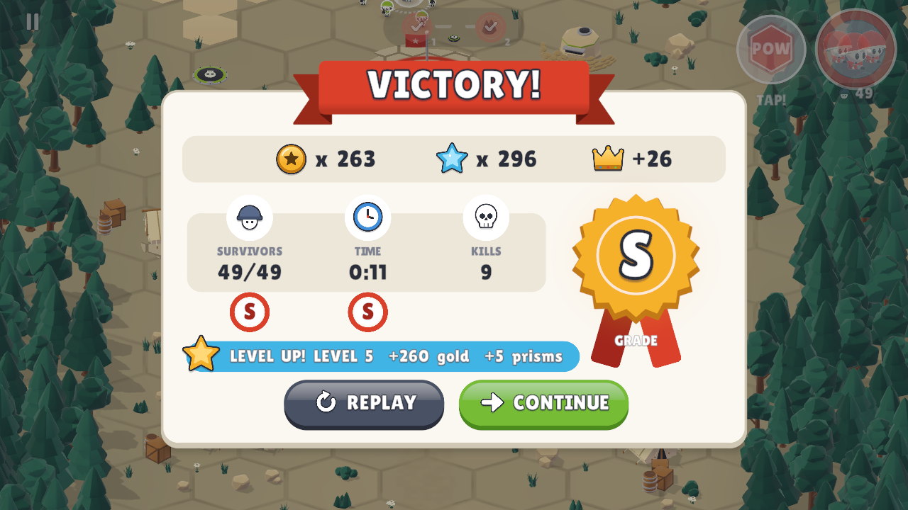 (`Screenshots/ui_victory.png`) |
| Side by side |  (`Comparisons/06_victory_screen.png`) |

What the images show: both are a white rounded card over a darkened battlefield with a currency row (gold coin, XP, a rank counter), grade letters in red rings and a gold medal with a grade letter, in a bold rounded display font. Reference has a red banner strip with a soldier walking to a target, four stats (medals, survivors, combos, time), a grey VICTORY plate on a red ribbon and a home plus next button pair. Ours has a red "VICTORY!" ribbon on top, three stats (survivors 49/49, time 0:11, kills 9), an S rosette, a blue "LEVEL UP" bar and REPLAY and CONTINUE buttons.

Differences:
- No banner strip with the walking soldier; different stat set (kills instead of medals and combos); different button set; our layout is cleaner and more modern.
- The grade is shown as a rosette (ours) versus a medal hung from a ribbon (reference).
- In the capture the HUD fades behind the card and the biome differs.

Required fixes (not done): banner strip, medal ribbon layout, home and next buttons if exact layout is wanted.

Verification status: **compared with visible differences** (vocabulary matches, layout does not).

## 8. Menus and base editor (no usable reference)

The references include only one map screen frame set (`References/video_frames/f_0090.jpg`, `f_0091.jpg`, `f_0094.jpg`, 360p with a streamer facecam) and nothing for the base editor, research, army, profile, settings or defeat screens (`REFERENCE_COMPARISON.md` section 10). These screens are our own design in the same visual language (white cards, red ribbons, rounded display font, chunky coloured buttons).

| Screen | Unity screenshot |
|---|---|
| Main menu | 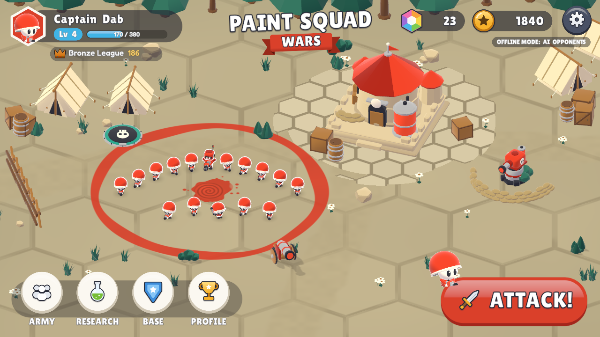 |
| Attack list | 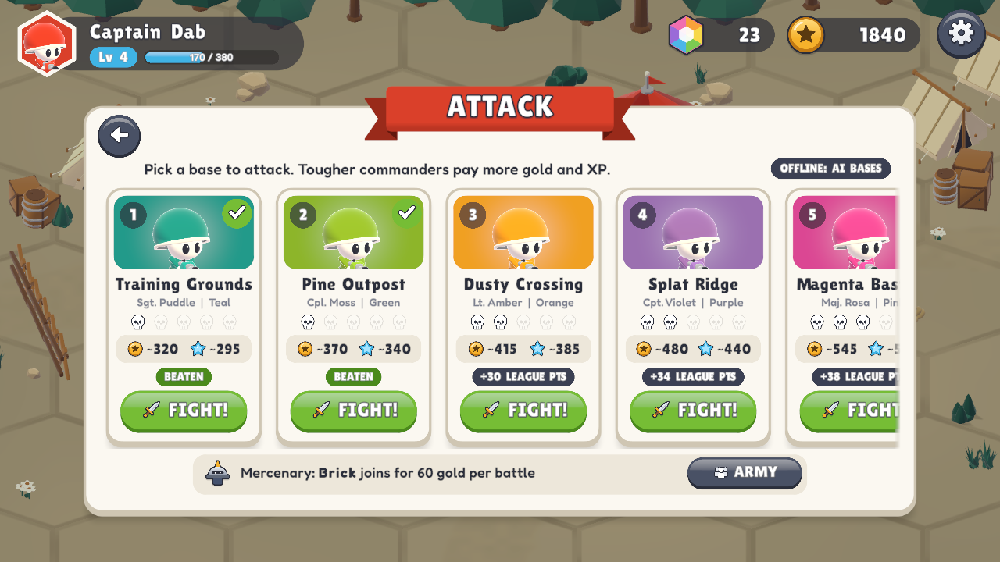 |
| Research | 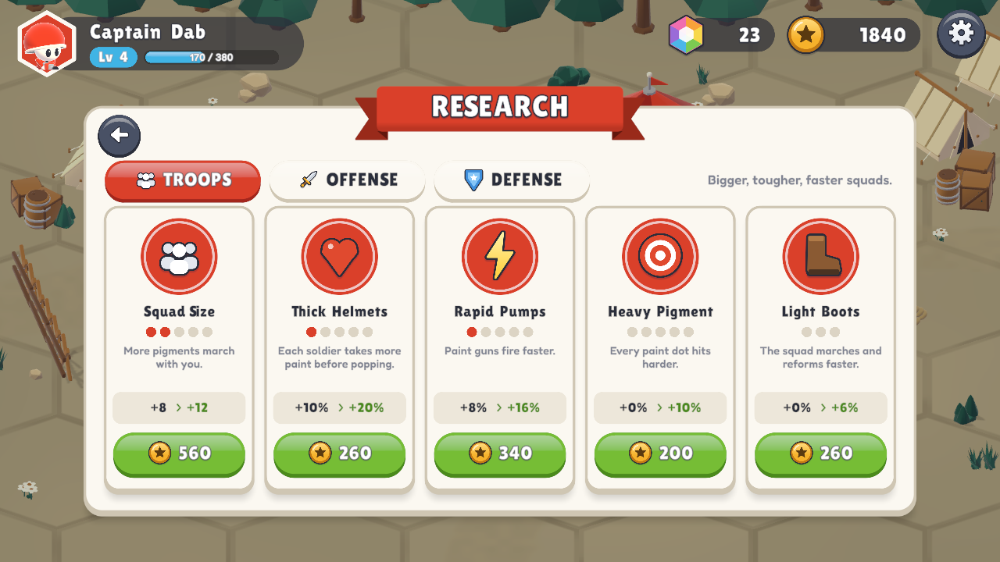 |
| Base editor | 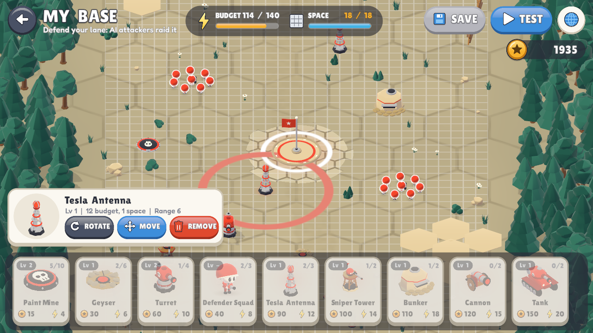 |
| Defense battle | 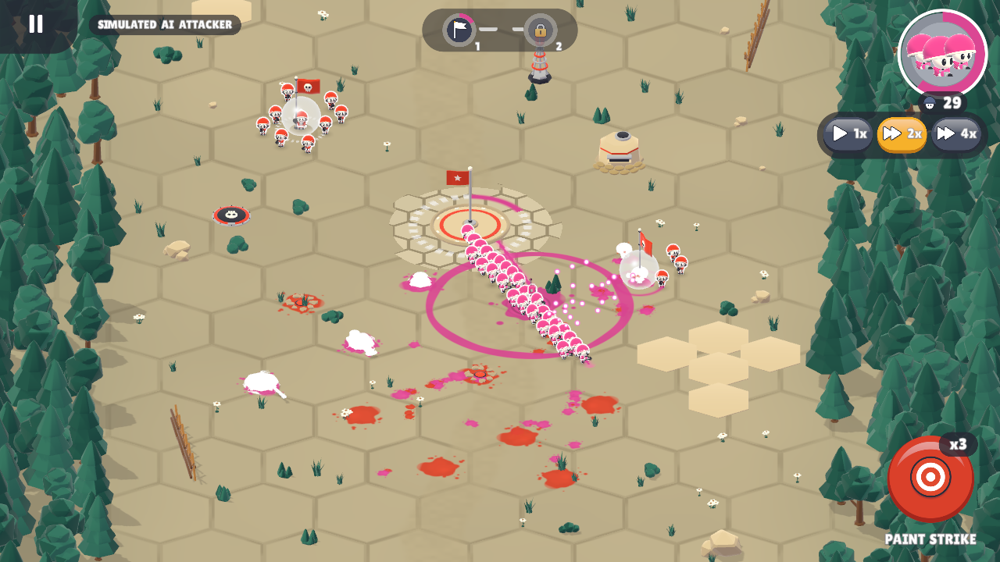 |
| Defeat | 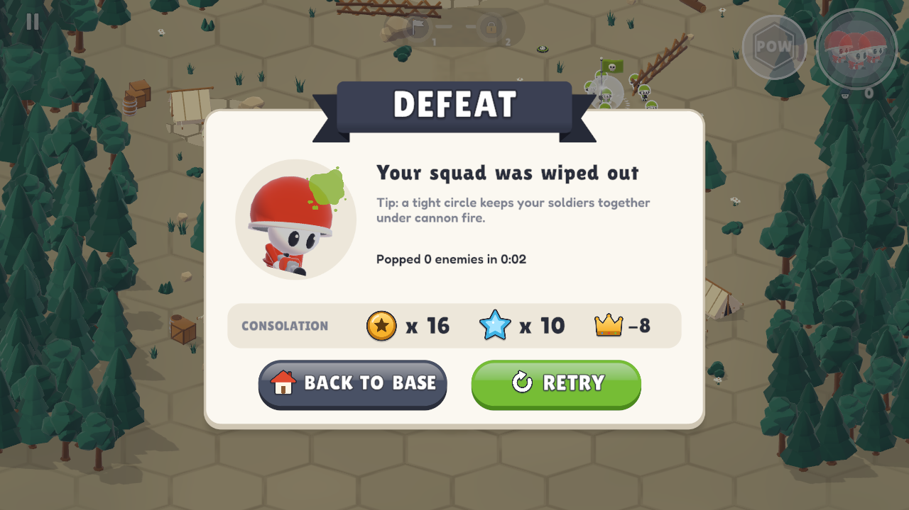 |
| Map variant (Canyon Pass) | 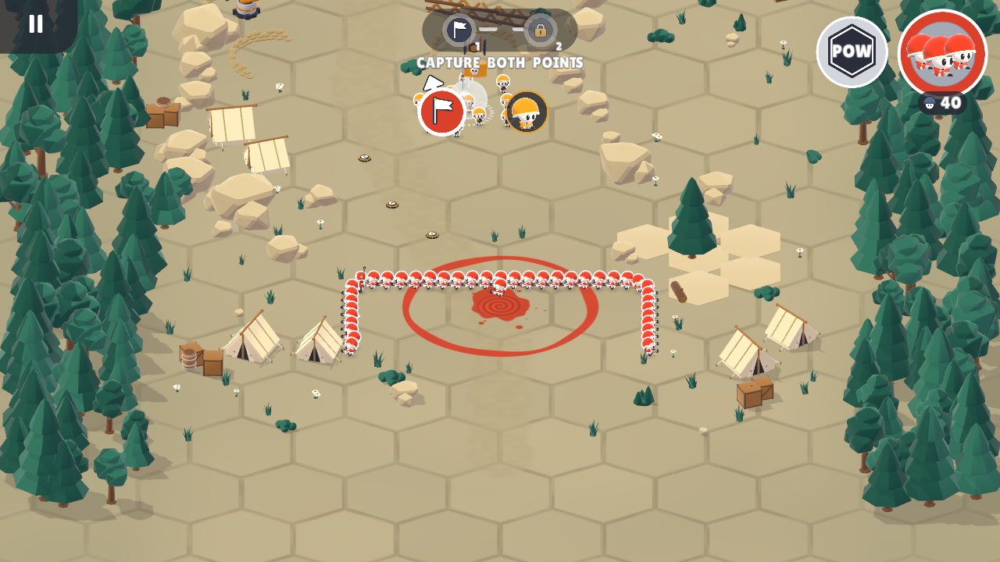 |
| Defense showcase | 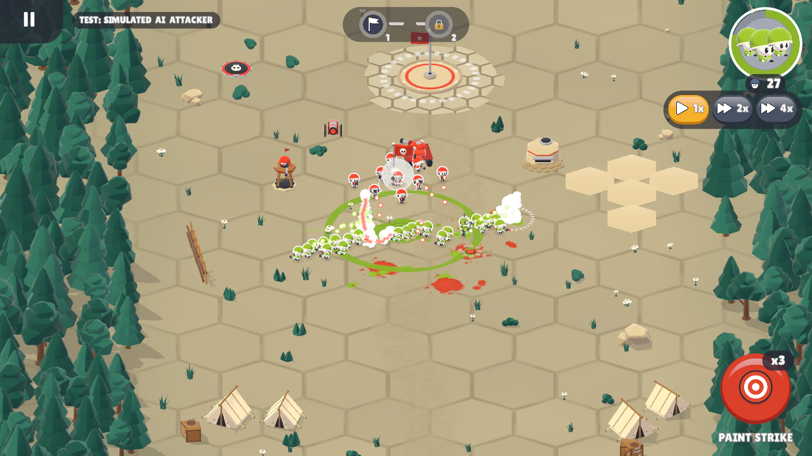 |

Observations made by viewing these: the main menu shows the title "PAINT SQUAD WARS", player card, gold and prism counters, a base with the HQ and defenses on sand hex ground, four round tab buttons (Army, Research, Base, Profile) and a large red ATTACK button, plus an "OFFLINE MODE: AI OPPONENTS" tag. The attack list shows ten AI base cards (five visible) with colour portraits, skulls for difficulty and reward estimates. The base editor shows a placement grid over the lane, a budget and space readout, a selected-defense card with rotate, move and remove, and a tray of nine defense cards with prices; it is a real tool, but the grid, defense discs and UI are tinted by the post stack. The defense battle shows speed buttons, a paint strike button and a "SIMULATED AI ATTACKER" label.

Known visual issues on these screens: post-processing tint on all UI; the attack list cuts off the fifth card at the edge (it is a horizontal scroll); the Canyon Pass and Fort Ridge maps reuse the same props with a different layout.

Verification status: **no reference available**. These are not judged against the original; the only claim made is that they were viewed in the screenshots above.

## Summary of open visual gaps

1. No lava biome or rain (the main references show grey lava ground).
2. Enemy density and spacing are lower and tighter than the reference.
3. Bubble arc is thin where the reference is thick.
4. White outline on soldiers heavier than the reference rim; faces and eyes small.
5. Post-processing tints the HUD.
6. Victory card layout differs from f_0086.
7. HUD badge art differs (colour contrast of busts) and has extra elements.
