

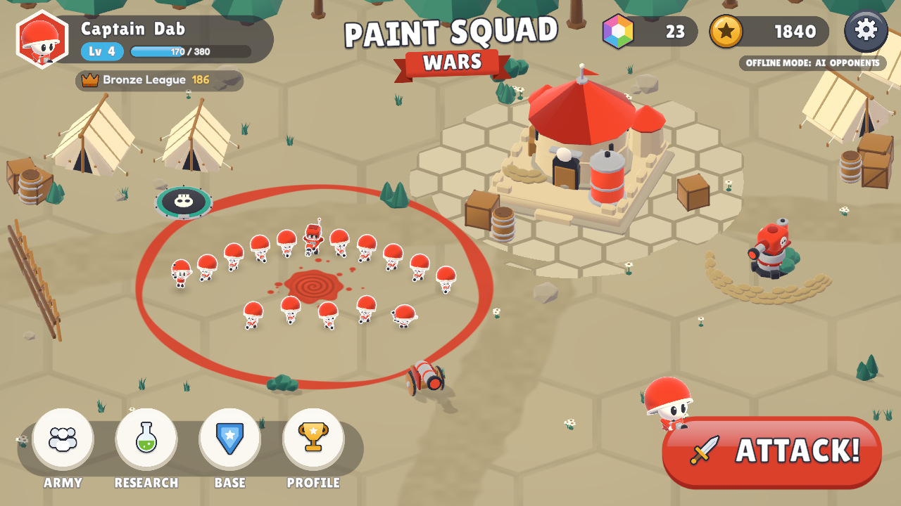

# Paint Squad Wars

**Draw a line. Your army becomes the line.**

A one-finger paint-gun strategy game built in Unity 6, where you command a squad of
tiny helmeted soldiers by drawing their formation straight onto the battlefield.

---

## The idea

Drag your finger across the ground and forty soldiers run to stand along the stroke.
A line gives you a firing wall. A ring protects a capture point. A wide arc wraps an
enemy squad. Tap to march with the shape intact. Everything else (aiming, firing,
dodging around walls) the squad handles for you.

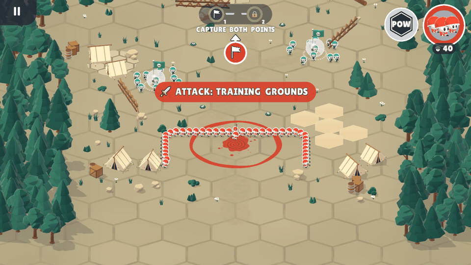

## Features

<table>
<tr>
<td width="50%" valign="top">

### Formation drawing
Strokes are smoothed, resampled by arc length, and recognized as a line, circle,
square, or free shape. Soldiers are assigned to slots so that no two paths cross,
and they stream along the stroke while you are still drawing it.

</td>
<td width="50%">
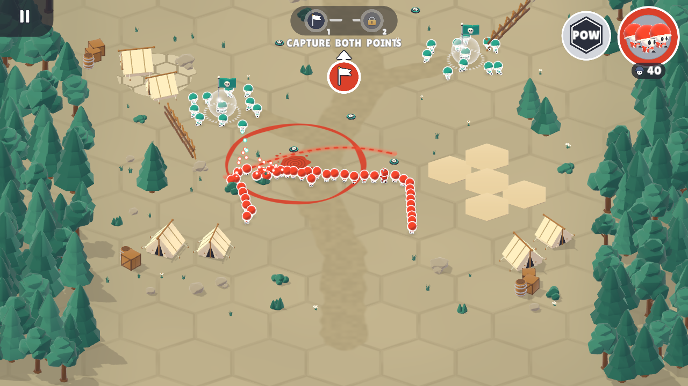
</td>
</tr>
<tr>
<td width="50%">
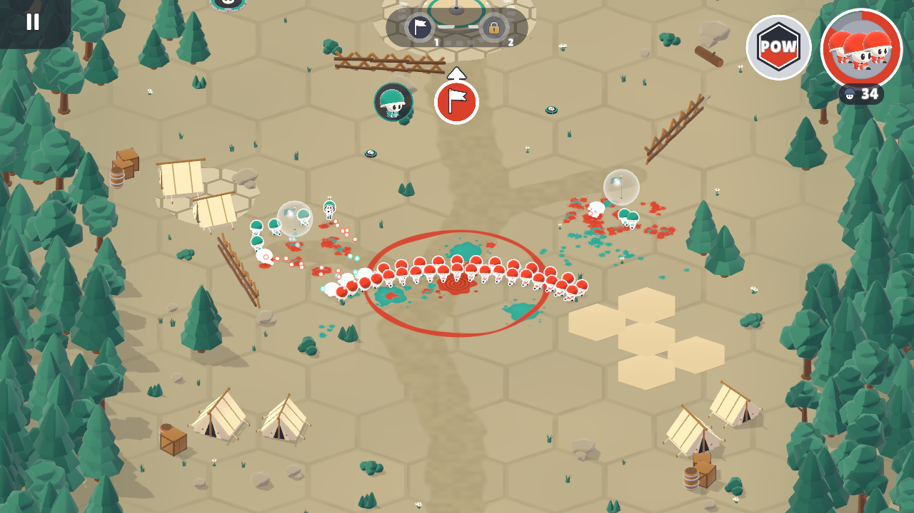
</td>
<td width="50%" valign="top">

### Paint combat
Soldiers auto-target and fire dotted streams of paint. Hits leave splats in the
shooter's color. Pop an enemy flag bearer, then tap the bubble it leaves behind to
wipe out its whole squad. Fill the POW badge with kills to call in reinforcements.

</td>
</tr>
<tr>
<td width="50%" valign="top">

### Build and defend your base
Place turrets, mines, tanks, cannons, bunkers, tesla antennas, sniper towers, and
geysers on a grid, inside a budget and a space cap. Save the layout, then watch an
AI attacker try to break it at up to 4x speed.

</td>
<td width="50%">
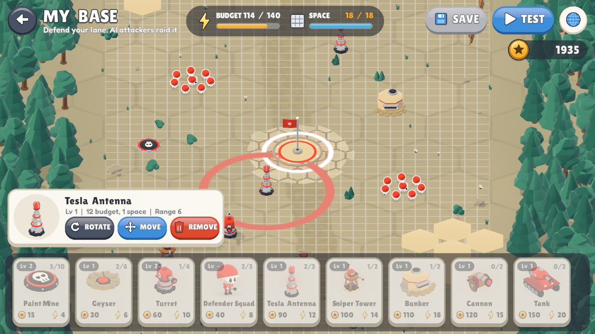
</td>
</tr>
<tr>
<td width="50%">
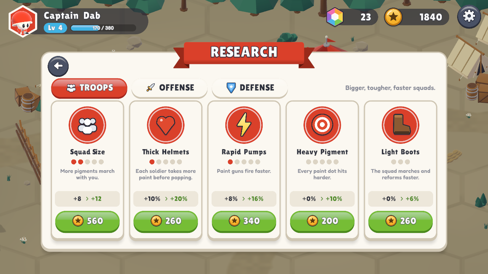
</td>
<td width="50%" valign="top">

### Progression that changes the fight
Ten AI bases across three maps, a three-branch research tree, hireable mercenaries,
levels, leagues, gold, and prisms. Upgrades feed the battle loadout directly: buy
Squad Size and more soldiers spawn. Progress is saved to disk.

</td>
</tr>
</table>

## Gallery

| | | |
|:-:|:-:|:-:|
| 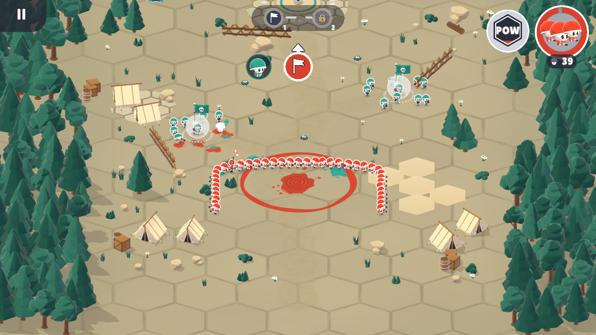 | 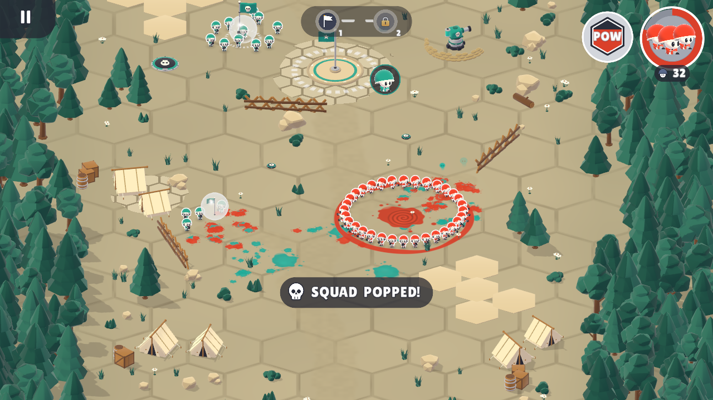 | 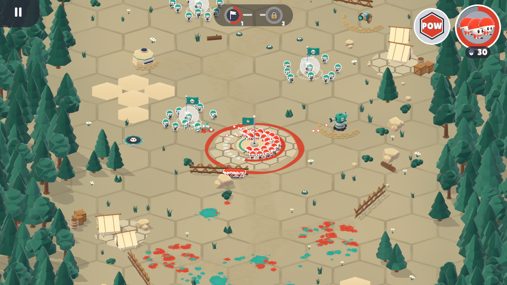 |
| U formation around the squad ring | Ring formation | Capturing a point |
| 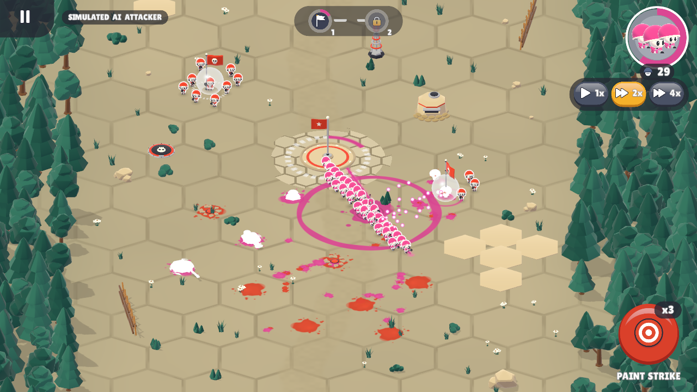 | 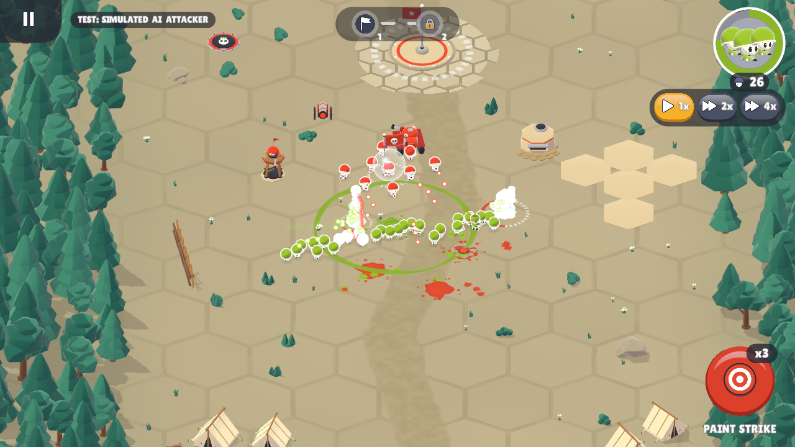 | 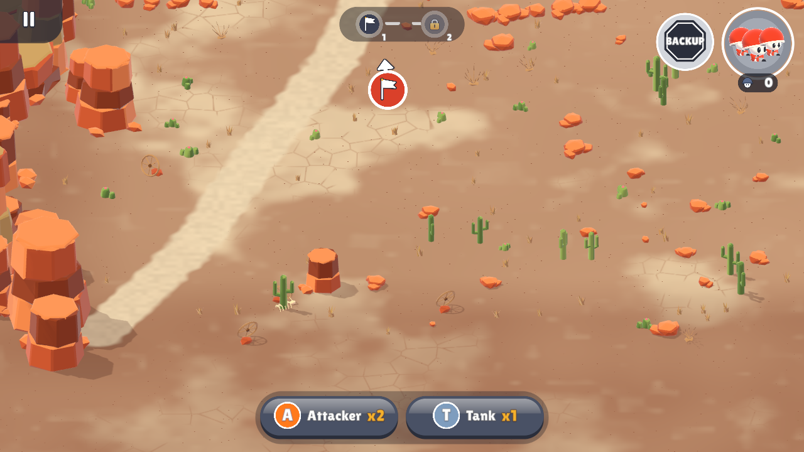 |
| AI attackers raiding a player base | The defense roster | Canyon Pass |
| 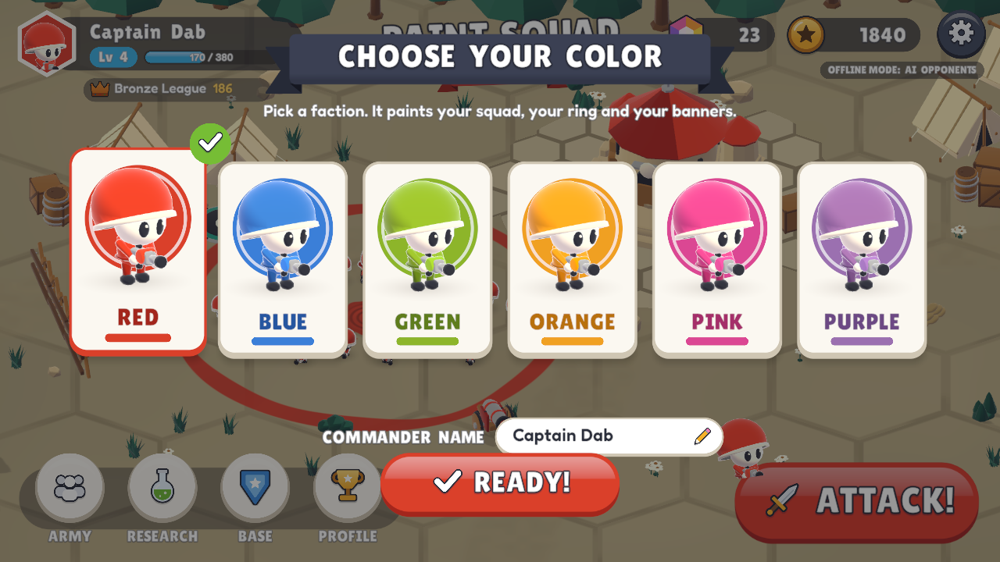 | 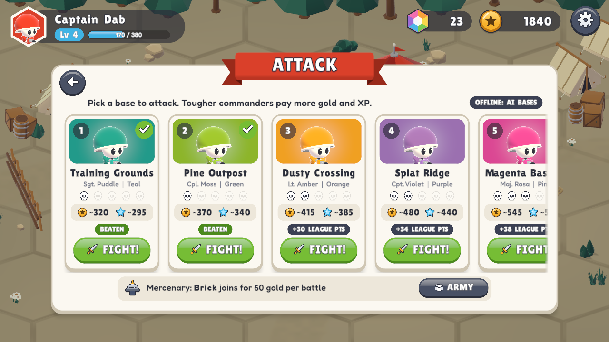 | 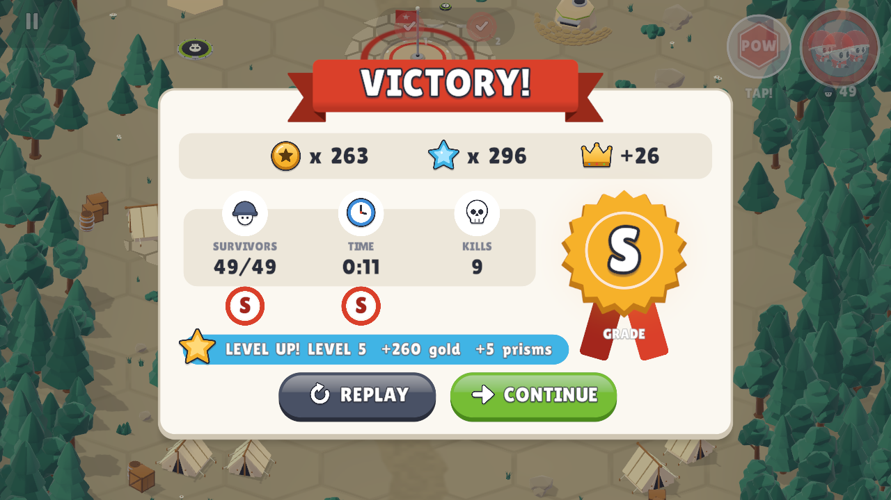 |
| Pick a faction color | Choose a base to attack | Victory |

## The art is generated, not downloaded

Every model in the game is built by a Blender Python script in [`Tools/blender`](Tools/blender),
every sound is synthesized by a script in [`Tools/audio`](Tools/audio), and every
scene, prefab, and material is assembled by Unity editor automation. Nothing comes
from an asset store, and the whole project can be regenerated from code.

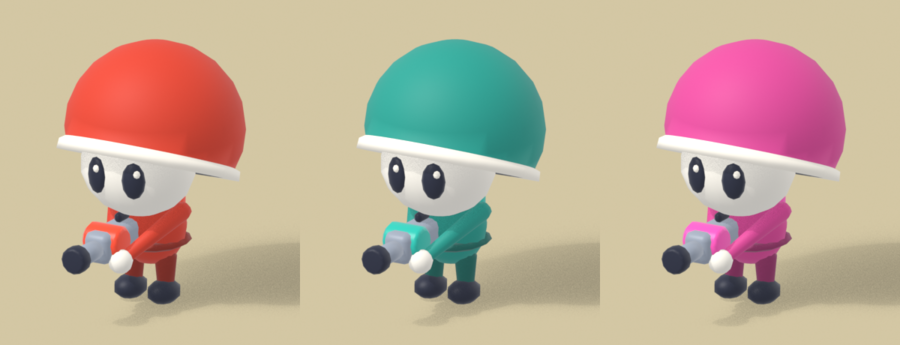
  
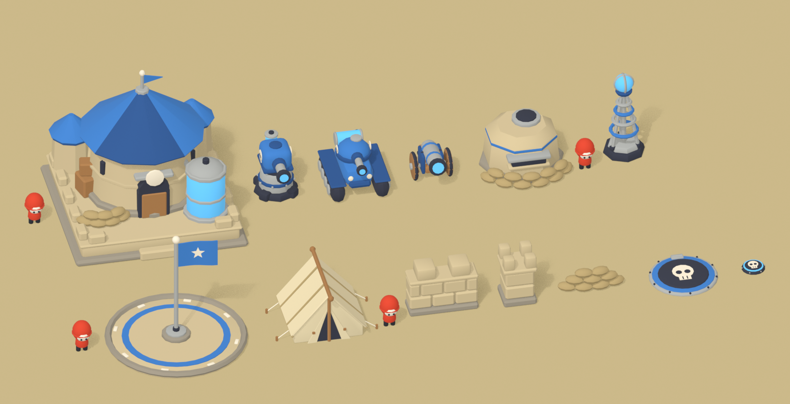
  
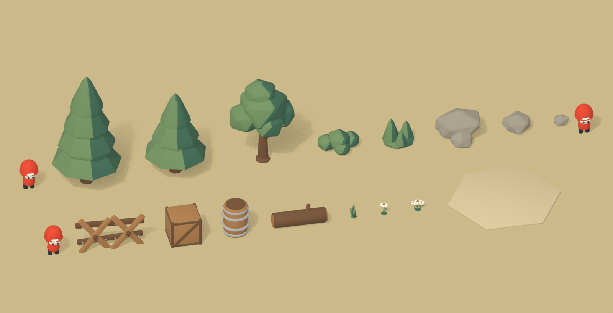

## Play it

1. Install [Unity Hub](https://unity.com/download) and editor version **6000.3.22f1**.
2. Clone this repository and add the folder in Unity Hub.
3. Open `Assets/Scenes/Boot.unity` and press Play.

| Action | Control |
|---|---|
| Reshape the squad | Drag on the ground |
| March, keeping formation | Tap or click the ground |
| Wipe out a squad | Tap the bubble left by its flag bearer |
| Call reinforcements | Tap the POW badge when full, or press `R` |
| Place a defense (base editor) | Drag a card onto the map |

A Web build made from this project is in [`TactileWarsWeb`](TactileWarsWeb).

## Under the hood

| Area | Approach |
|---|---|
| Rendering | URP, a custom toon shader with outlines, a procedural hex-tile ground shader, pooled paint decals |
| Formations | Chaikin smoothing, arc-length resampling, shape recognition, crossing-free slot assignment |
| Movement | Per-soldier steering with separation, plus a coarse grid router so squads path through gates |
| Architecture | Gameplay raises events and never references UI; all tunables live in ScriptableObjects |
| Save | Versioned JSON with atomic writes, a backup file, and corruption fallback |
| Automation | One menu (`TactileWars > Build Everything`) rebuilds materials, prefabs, data, and all four scenes |
| Tests | 42 edit-mode and 30 play-mode tests, including a bot that plays whole battles through the real input path |

Measured in the Unity editor on an Apple M2: about 9.8 ms of main-thread CPU per
frame in the heaviest attack battle. Details are in
[`Docs/PERFORMANCE_REPORT.md`](Docs/PERFORMANCE_REPORT.md).

## Honest status

This is a working game, not a finished product. What you should know:

- **Not tested on phones.** It runs in the editor on macOS. Draw calls (about 5,000
  in a big battle) need batching work before a mobile build is realistic.
- **Balance values are estimates.** The first base is comfortably winnable; the
  hardest one is not reliably beatable yet.
- **Offline only.** Raids, the leaderboard, and alliances are simulated locally and
  labeled that way in the UI. There is no multiplayer server.
- **Audio is synthesized and lightly mixed.** Levels were set by measurement and
  still need tuning by ear.

The full list is in [`Docs/STATUS_CHECKLIST.md`](Docs/STATUS_CHECKLIST.md).

## Documentation

| Document | What it covers |
|---|---|
| [`Docs/PROJECT_GUIDE.md`](Docs/PROJECT_GUIDE.md) | Setup, controls, editor menu, batch commands, build steps |
| [`Docs/GAME_DESIGN_DOCUMENT.md`](Docs/GAME_DESIGN_DOCUMENT.md) | Design pillars, core loop, systems |
| [`Docs/GAMEPLAY_MECHANICS.md`](Docs/GAMEPLAY_MECHANICS.md) | Mechanic-by-mechanic spec with every tunable |
| [`Docs/VISUAL_STYLE_GUIDE.md`](Docs/VISUAL_STYLE_GUIDE.md) | Camera, palette, characters, UI language |
| [`Docs/ARCHITECTURE_CONTRACT.md`](Docs/ARCHITECTURE_CONTRACT.md) | Folder layout, asset contract, system map |
| [`Docs/TESTING.md`](Docs/TESTING.md) | How to run the test suites and what they cover |

## Credits and licenses

Paint Squad Wars is a fan study of the design of *Tactile Wars* (Ankama, 2015).
It is unofficial and is not affiliated with or
endorsed by Ankama. No code, art, or audio from the original game is included.

- Models, shaders, textures, UI art, and audio: original, generated for this project.
- Fonts: [Lilita One](https://fonts.google.com/specimen/Lilita+One) and
  [Fredoka](https://fonts.google.com/specimen/Fredoka), both under the SIL Open Font
  License (see [`Assets/Art/Fonts/LICENSES.md`](Assets/Art/Fonts/LICENSES.md)).

Built by [Manas Vardhan](https://github.com/ManasVardhan).
